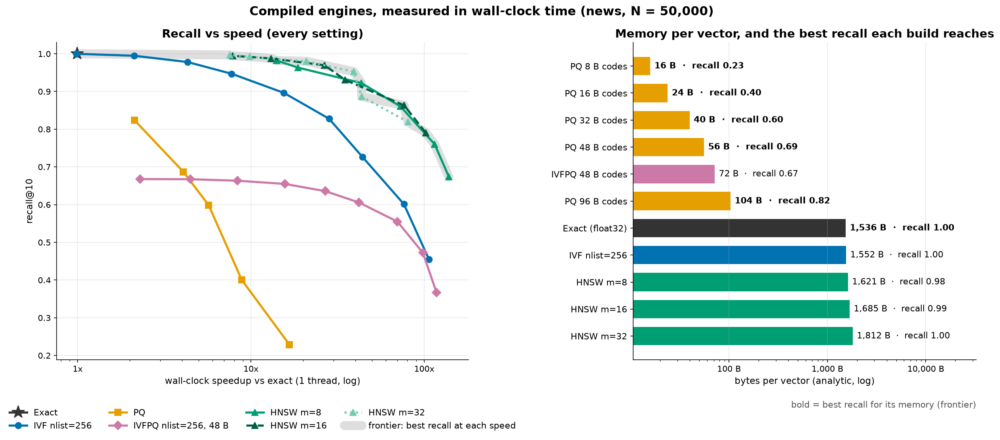

# vector_search_101

**Exact nearest-neighbour search is perfect, and that is exactly why it does not scale.**

A hands-on introduction to approximate nearest-neighbour search, the engine inside every vector database, built from scratch on CPU.

Finding the stored vectors closest to a query is easy to get right: compute the distance to every one of them and keep the smallest. It is also hopeless at scale, because that cost grows in lockstep with the database. Every fast vector search therefore skips most of the comparisons and accepts a measurable chance of missing a true neighbour. This project builds the methods that make that trade (an inverted file, product quantization, IVF + PQ, HNSW and random-hyperplane LSH) from scratch in numpy, checks each one against faiss and hnswlib, and measures what each gives up: recall, speed or memory.



*No index wins on all three axes. Left: HNSW gives the most recall per millisecond. Right: PQ gives the most recall per byte, and HNSW keeps every float plus its links. A vector database picks a point on these curves for you.*

## What it shows

Every number below comes from the executed notebooks (`outputs/results/*.json`, seed 42), measured on a 2-vCPU GitHub Codespace (Intel Xeon Platinum 8370C) with every engine pinned to one thread. Recall is recall@10 against exact search on 1,000 held-out queries.

| Finding | Evidence |
|---|---|
| **Exact search is always right and linear in N.** | It matches a textbook implementation and faiss `IndexFlatL2` on all 200 queries checked. One query takes 0.6 ms at 10,000 vectors (384-d) and 61 ms at 500,000, on a straight line (R² 0.999). Extrapolated: 123 ms at a million vectors, 12.3 s at a hundred million, plus 154 GB of floats. |
| **Recall is a dial.** | IVF on 50,000 sentence embeddings with 256 lists: scanning 1 list gives recall 0.42, 16 lists 0.89, 32 lists 0.94, all 256 exactly 1.00. At 32 lists it scores 7.4x fewer vectors than exact search; faiss turns that into an 8.5x wall-clock speedup. |
| **Misses happen at cluster borders.** | At `nprobe = 1`, the quarter of queries sitting closest to a cell border get recall 0.22; the quarter farthest from one get 0.73. |
| **Structure is what IVF exploits.** | Four lists give recall 1.00 on clustered synthetic data and 0.11 on an isotropic Gaussian of the same dimension. |
| **PQ buys memory with recall.** | 48-byte codes store a 1,536-byte vector in 56 bytes (codebooks included, 27x smaller) at recall 0.68; 8-byte codes go 97x smaller at recall 0.23. IVF + PQ plateaus at 0.67 however many lists it scans, in a 3.6 MB index instead of 76.8 MB of floats. |
| **HNSW search is sub-linear.** | The from-scratch graph on 20,000 vectors scores 989 per query (4.9 percent) at recall 0.98. faiss's HNSW on 200,000 clustered vectors scores 0.31 percent at recall 0.99; growing the database 128-fold keeps the work between 277 and 614 vectors. `ef_search` slides recall from 0.82 to 1.00 with no rebuild. |
| **HNSW pays in memory and build time.** | 1,680 bytes per vector at `m = 16`, more than the 1,536 bytes of floats alone. The pure-Python build took 51 s for 20,000 vectors; hnswlib took 3.0 s. |
| **No index dominates.** | Exact, HNSW, IVF, IVFPQ and PQ all own part of the computed recall-speed-memory frontier. LSH is fully dominated on these dense embeddings: it needs 128 bands and 2,688 bytes per vector to reach recall 0.97 at a 2.5x work saving, where HNSW reaches 0.99 at 11.8x. |
| **An index pays when exact search leaves your budget.** | On clustered vectors, exact search takes 0.28 ms per query at 12,500 vectors and 9.8 ms at 200,000. At 200,000, tuned HNSW answers in 0.056 ms and tuned IVF in 0.125 ms (recall at least 0.95) after 17 s and 22 s of building. |
| **Recall-test on a sample.** | 200 brute-force queries pin recall down to plus or minus 0.035; 25 queries only to plus or minus 0.10. |
| **The from-scratch indexes match the libraries.** | PQ and IVFPQ recall within 0.005 of faiss, HNSW within 0.004 of hnswlib; work per query within tolerance of faiss's own counters; analytic index sizes within 0.1 percent of faiss (PQ) and 0.3 percent of hnswlib. |

## The notebooks

| | Notebook | The point |
|---|---|---|
| 01 | [Exact and why it fails](notebooks/01_exact_and_why_it_fails.ipynb) | Brute force in two lines defines ground truth; its query time and memory grow linearly with N. |
| 02 | [Inverted file](notebooks/02_inverted_file.ipynb) | Cluster with k-means, scan only the nearest lists. `nprobe` is a recall dial; misses sit across cell borders. |
| 03 | [Product quantization](notebooks/03_product_quantization.ipynb) | Vectors become a few bytes, distances come from table lookups, recall pays. IVFPQ pulls both levers. |
| 04 | [HNSW from scratch](notebooks/04_hnsw_from_scratch.ipynb) | A layered graph walked greedily: one query's path, sub-linear work, and what `m` and `ef_search` cost. *(Showpiece.)* |
| 05 | [The triangle](notebooks/05_the_triangle.ipynb) | Every index on recall, speed and memory, in work (from scratch) and wall-clock time (faiss, hnswlib). The frontier is computed, not eyeballed. |
| 06 | [Decision framework](notebooks/06_decision_framework.ipynb) | When an index pays for itself, which knob moves which corner, and how many queries you need to recall-test one. |

### Which index

| Situation | Choose |
|---|---|
| Under a few hundred thousand vectors and the latency budget is met | exact search (numpy or faiss `IndexFlatL2`) |
| Best recall per millisecond, memory available | HNSW (`m` 16, raise `ef_search` until recall is high enough) |
| Memory or build time matter more than the last bit of speed | IVF (`nlist` about the square root of N, tune `nprobe`) |
| Memory is the hard limit | PQ or IVFPQ, optionally re-ranking the shortlist with full vectors |
| Streaming inserts, no training, set or near-duplicate similarity | LSH (see `hashing_101`) |

Whatever you choose, measure its recall against exact search on a few hundred queries (`recall_on_sample` below).

## Quickstart

Runs in a 2-CPU / 8 GB GitHub Codespace, no GPU.

```bash
make setup       # uv, dependencies (CPU-only torch), Jupyter kernel
make data        # 20 Newsgroups sentences -> MiniLM embeddings, synthetic sets, exact ground truth (~10 min, once)
make test        # 79 tests, ~30 s, offline
make notebooks   # executes all six notebooks in place (~17 min), fails if any takes over 7 min
make run         # the Streamlit app on :8501
```

Use the library directly:

```python
from src.datasets.vectors import load_dataset
from src.evaluation.recall import recall_on_sample
from src.indexes.hnsw import HNSWIndex

news = load_dataset("news")                      # 50,000 x 384 sentence embeddings + 1,000 queries
base = news.base[:5000]
index = HNSWIndex(m=16, ef_construction=64, ef_search=32)
index.add(base)                                  # pure Python: ~10 s for 5,000 vectors

est = recall_on_sample(index, base, news.queries, k=10, n_sample=200)
print(f"recall@10 = {est.mean:.3f} (95% CI {est.ci_low:.3f} to {est.ci_high:.3f})")
print(f"vectors scored per query: {index.last_stats.ndis.mean():.0f} of {len(base):,}")
```

Every index (`ExactIndex`, `IVFIndex`, `PQIndex`, `IVFPQIndex`, `HNSWIndex`, `LSHIndex`, and the faiss / hnswlib wrappers in `src/reference/compare.py`) has the same faiss-shaped interface: `train`, `add`, `search(xq, k) -> (distances, ids)`, `nbytes` and `last_stats` (work per query).

## The app

`make run` opens four tabs: **Scaling wall** (exact search's latency against N, and a button to time it yourself), **Index explorer** (pick IVF, PQ, IVFPQ or HNSW, move the knobs, watch recall, latency, memory and build time move together), **The triangle** (every index on recall-speed and recall-memory axes) and **Query inspector** (one held-out query: the lists IVF probed and the path HNSW walked, with each returned sentence marked as a true neighbour or a miss).

## How it works

- **Exact** (`src/indexes/exact.py`): squared L2 via `||q||^2 + ||x||^2 - 2 q.x` in float32, `argpartition` for the top k. It defines the ground truth every recall number is measured against.
- **IVF** (`ivf.py`): k-means (scikit-learn, random init as faiss does) learns `nlist` centroids; each vector goes into its nearest centroid's list; a query scans the `nprobe` nearest lists exactly.
- **PQ** (`pq.py`): each vector is split into sub-vectors, each sub-vector replaced by the index of its nearest codeword in a 256-entry codebook (one byte). Search builds a 256-entry distance table per sub-vector and sums lookups (asymmetric distance computation).
- **IVFPQ** (`ivfpq.py`): IVF lists holding PQ codes of each vector's residual from its centroid.
- **HNSW** (`hnsw.py`): Malkov and Yashunin's graph with hnswlib's choices: geometric levels with `mL = 1/ln(m)`, the diversity heuristic for picking links, `2m` links on layer 0 and `m` above, greedy descent then a beam search of width `ef_search`. Layer-0 links live in a numpy array so a node's neighbours are scored in one call.
- **LSH** (`lsh.py`): random hyperplanes (Charikar 2002) with `hashing_101`'s banding, on centred vectors, candidates re-ranked exactly.

Speed is measured in two currencies that never share an axis. **Work** (vectors scored per query) compares from-scratch code fairly and is what the tests assert. **Wall-clock time** (median single-query latency, one thread) is reported only for compiled engines, because a pure-Python search loop measures the interpreter rather than the algorithm. Memory is the analytic size of the compact layout a C++ index would hold (vectors, codes, ids, centroids, codebooks, link slots), checked against faiss's serialised sizes.

The tests (`tests/`) assert the claims rather than the timings: exact search equals a naive reference; IVF recall is non-decreasing in `nprobe` with no tolerance and exactly 1.0 when every list is scanned; the HNSW graph respects its link caps, is navigable from its entry point and scores a shrinking share of a growing database; the LSH collision rate follows the theoretical S-curve; and every from-scratch index matches faiss or hnswlib within tolerance.

## Project structure

```
config/settings.yaml      every knob and seed
src/
  config.py               settings (pydantic-settings, YAML, env overrides VS101_*)
  artifacts.py            paths, save_figure / save_json
  metrics/distance.py     squared L2, inner product, cosine
  indexes/                exact, ivf, pq, ivfpq, hnsw, lsh (+ the shared Index protocol)
  reference/compare.py    faiss and hnswlib behind the same protocol
  datasets/vectors.py     news embeddings, synthetic sets, held-out queries, exact ground truth
  evaluation/             recall, speed (work and wall-clock), memory, triangle (sweeps, Pareto frontier)
  visualisation.py        every figure
app/streamlit_app.py      the four-tab app
notebooks/                01 to 06, executed, outputs committed
tests/                    79 tests
outputs/figures/          15 figures
outputs/results/          the numbers behind every figure and claim
```

## Limitations

- **Scale.** From-scratch indexes are measured on up to 50,000 vectors (HNSW on 20,000), faiss and hnswlib on up to 200,000, exact search on up to 500,000. Billion-scale systems (DiskANN, sharding, disk-resident indexes) are out of scope, and the 1M and 100M points in notebook 01 are extrapolations.
- **One real corpus.** 20 Newsgroups sentences embedded with `all-MiniLM-L6-v2`. Other models and corpora move the curves; the qualitative picture (recall as a dial, no dominant index) is what carries over.
- **Timing noise.** Wall-clock numbers come from a shared 2-vCPU virtual machine on one thread; below 0.1 ms per query the call overhead dominates and neighbouring settings can swap places. Absolute speeds are hardware-specific, which is why the results are reported as speedups over exact search.
- **Pure Python is slow.** The from-scratch HNSW builds about 17x slower than hnswlib; its speed claims are made in work, not seconds.
- **LSH is the basic variant.** Random hyperplanes with banding and one bit width; multi-probe LSH and learned hashing do better.
- **Not covered.** Filtered and hybrid search, updates and deletes, GPU indexes.

## Related projects

Other hands-on projects in the same series ([github.com/Dima806](https://github.com/Dima806)):

**Where the vectors come from**
- [embeddings_101](https://github.com/Dima806/embeddings_101): how text becomes vectors, from co-occurrence counts to word2vec and the sentence encoder used here.
- [transformers_101](https://github.com/Dima806/transformers_101): the architecture inside that sentence encoder, built from scratch in numpy.
- [tokenization_101](https://github.com/Dima806/tokenization_101): the step before the encoder sees any text.

**Ideas the indexes reuse**
- [hashing_101](https://github.com/Dima806/hashing_101): MinHash and banded LSH for sets; this project swaps in random hyperplanes for dense vectors.
- [quantization_101](https://github.com/Dima806/quantization_101): scalar quantization of model weights; PQ is the same idea with a learned codebook per sub-vector.
- [distance_arena](https://github.com/Dima806/distance_arena): eight distance measures compared; on unit-length embeddings, L2, cosine and inner product rank identically.
- [curse_of_dimensionality_101](https://github.com/Dima806/curse_of_dimensionality_101): why distances concentrate in high dimension, and why the isotropic control is so hard to index.
- [dim_reduction_arena](https://github.com/Dima806/dim_reduction_arena): PCA, random projections and friends, on data whose true structure is known.

**Search in practice**
- [retrieval_arena](https://github.com/Dima806/retrieval_arena): TF-IDF, BM25, dense and hybrid retrieval compared, and the measurement that numpy brute force is fine below about 500,000 vectors.
- [rag_101](https://github.com/Dima806/rag_101): retrieval-augmented generation end to end; its retrieve step is exactly this search.
- [recommender_101](https://github.com/Dima806/recommender_101): recommendation from scratch, where item-to-item similarity is a nearest-neighbour lookup.
- [metrics_101](https://github.com/Dima806/metrics_101): precision, recall and friends, the vocabulary behind recall@k.

## References

- Malkov, Y. and Yashunin, D. (2018). Efficient and Robust Approximate Nearest Neighbor Search Using Hierarchical Navigable Small World Graphs. *IEEE TPAMI.*
- Jégou, H., Douze, M. and Schmid, C. (2011). Product Quantization for Nearest Neighbor Search. *IEEE TPAMI.*
- Johnson, J., Douze, M. and Jégou, H. (2019). Billion-scale Similarity Search with GPUs. *IEEE Big Data.*
- Douze, M. et al. (2024). The Faiss Library. *arXiv:2401.08281.*
- Indyk, P. and Motwani, R. (1998). Approximate Nearest Neighbors: Towards Removing the Curse of Dimensionality. *STOC.*
- Charikar, M. (2002). Similarity Estimation Techniques from Rounding Algorithms. *STOC.*
- Aumüller, M., Bernhardsson, E. and Faithfull, A. (2020). ANN-Benchmarks: A Benchmarking Tool for Approximate Nearest Neighbor Algorithms. *Information Systems.*

## License

Apache-2.0. See [LICENSE](LICENSE).
